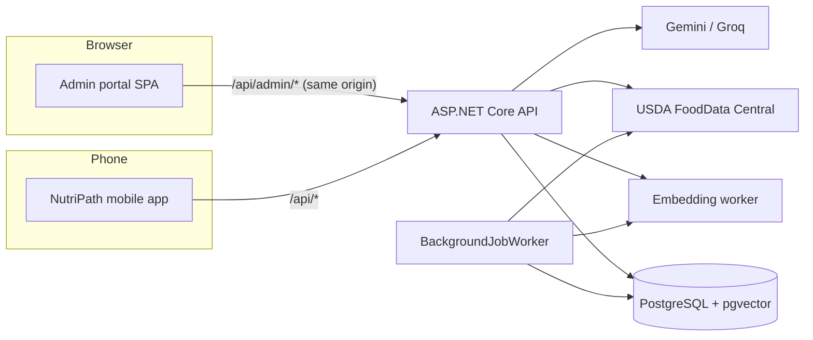
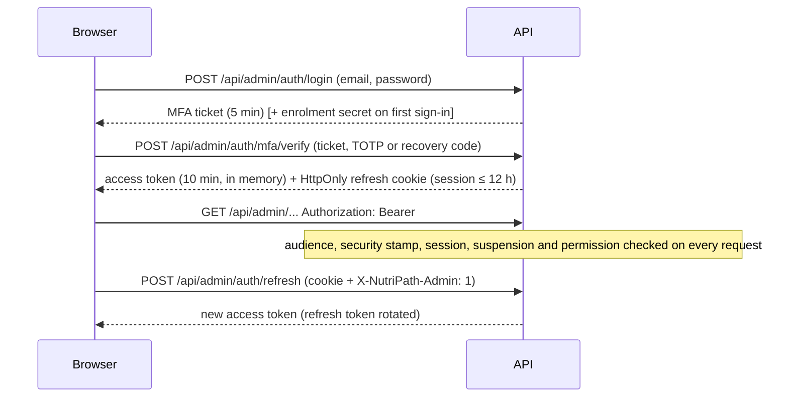
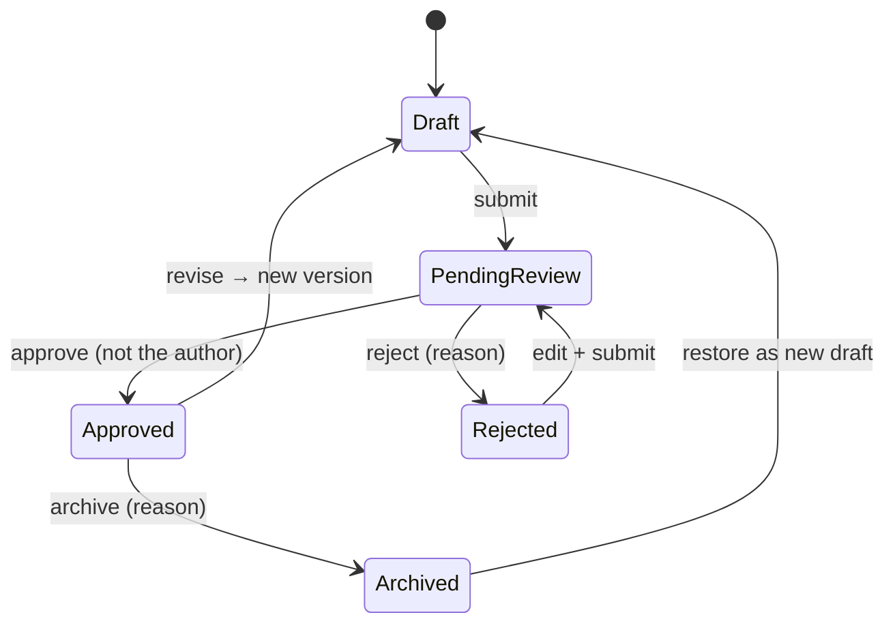

# NutriPath Admin Portal

A web portal for operating NutriPath: user accounts, administrators, AI providers and API keys,
the nutrition knowledge base, the food catalogue, background jobs, system health and the audit log.

- Frontend: `frontend/NutriPath.Admin` (Vite, React 19, TypeScript, Tailwind CSS 4, TanStack Query and Table, Radix UI, Recharts)
- Backend: the existing API, under `/api/admin/*` (`backend/NutriPath.Api/Controllers/Admin`, `Services/Admin`)
- Database: additive migration `AddAdminPortal`
- Tests: `tests/NutriPath.Api.Tests/AdminPortalTests.cs`, `AdminManagementTests.cs` (backend) and `frontend/NutriPath.Admin/src/test` (Vitest)

## Architecture



The portal is a static single-page app. It talks to the same API process as the mobile app, but
through a separate set of endpoints, a separate token audience and a separate authorization model.
Every page is also protected on the server: hiding a menu item is a convenience, not a control.

### Serving it

Serve the portal and the API from **one origin** (for example `https://admin.nutripath.example`
serving `dist/` for `/` and proxying `/api` to the API). The refresh cookie is `SameSite=Strict`
and scoped to `/api/admin/auth`, so no CORS configuration is needed. In development, Vite proxies
`/api` to `http://localhost:5092` (override with `NUTRIPATH_API_URL`).

```bash
cd frontend/NutriPath.Admin
npm ci
npm run dev        # http://localhost:5173
npm run build      # static files in dist/
```

Set `Admin:PortalUrl` on the API to the portal's public origin so invitation links point at it.

## Security model



| Control | How |
| --- | --- |
| Separate admin tokens | Audience `NutriPath.Admin`, scheme `AdminBearer`. Consumer tokens are rejected by admin endpoints and vice versa. |
| MFA is mandatory | TOTP (RFC 6238, SHA-1, 30 s, 6 digits, ±1 step) with replay prevention. Admin tokens are issued only after the second factor. The QR code is rendered in the browser; the secret is never sent to a third party. |
| Recovery codes | 10 single-use codes, stored as SHA-256 hashes, shown once. |
| Step-up for sensitive actions | Replacing, rolling back or revoking API keys and regenerating recovery codes need a second factor within the last 15 minutes (`reauth_required` → password + TOTP dialog). |
| Token storage | Access token only in memory. Refresh token in an `HttpOnly`, `Secure` (on HTTPS), `SameSite=Strict` cookie limited to `/api/admin/auth`. Nothing in `localStorage` except the theme and the sidebar state. |
| CSRF | Refresh and logout need the `X-NutriPath-Admin: 1` header and a same-origin or allow-listed `Origin`. |
| Instant revocation | A security stamp (`sv` claim) is checked on every request (cached 15 s). Suspension, role changes, MFA reset, password reset and session revocation take effect at once. |
| Brute force | Lockout after 5 failed sign-ins for 15 minutes; the auth rate limit applies to admin sign-in too. |
| Safe administration | Nobody can change their own roles or suspend themselves; the last active SuperAdmin can't be removed; only SuperAdmins grant SuperAdmin; consumer accounts can't be promoted (administrators use separate accounts, created by invitation or the CLI). |
| Audit | Append-only `AdminAuditLogs`: actor, roles, action, resource, outcome, correlation ID, reason. Denied attempts are logged. Secrets, passwords and health data are never written. CSV exports neutralise spreadsheet formulas. |
| Privacy | The portal shows account metadata and usage counts, not meal logs or assistant conversations. AI metrics store provider, model, language, tokens, latency and outcome only. The playground uses fictional profiles only. |

### API keys (Gemini, Groq, USDA)

- Keys pasted in the portal are tested against the provider with a free request (fixed, allow-listed URLs) and only a working key is stored and activated. A failing key leaves the current key in place.
- Stored keys are encrypted with **AES-256-GCM**. Each ciphertext is bound to its provider and version as associated data. Encryption keys are versioned and come from configuration, separate from the chat-message key:

  ```text
  Credentials:EncryptionKeys:1 = <base64 of 32 random bytes>
  Credentials:ActiveKeyVersion = 1
  ```

  Generate one with `openssl rand -base64 32`. Keep it in user secrets or the deployment secret store, never in `appsettings.json` or the repository.
- Only the last four characters are ever returned. Keys never appear in logs, the audit log, the frontend bundle or error messages.
- Precedence: a portal-managed key wins over the environment key (`Gemini:ApiKey`, `Groq:ApiKey`, `Usda:ApiKey`). Once a provider has any portal-managed key, the environment key isn't used again, so revoking a leaked key can't silently fall back to an old one.
- History supports reactivating an earlier version (tested first). Revoked versions can never be reactivated.

**Rotating the encryption key:** add `Credentials:EncryptionKeys:2`, set `ActiveKeyVersion` to 2, then replace each API key in the portal (new versions are encrypted with key 2). Remove key 1 only after no active or inactive credential uses it.

## Roles and permissions

The matrix is defined in code (`Models/Admin/AdminRoles.cs`) and shown read-only on the Roles page.

| Permission | SuperAdmin | UserAdmin | AIManager | NutritionReviewer | SupportAdmin |
| --- | :-: | :-: | :-: | :-: | :-: |
| dashboard.read | ✓ | ✓ | ✓ | ✓ | ✓ |
| users.read | ✓ | ✓ | | | ✓ |
| users.manage, users.suspend, users.revoke_sessions, users.export | ✓ | ✓ | | | |
| admins.read, admins.manage, admins.assign_roles | ✓ | | | | |
| ai.providers.read, ai.providers.manage, ai.models.manage, ai.evaluate | ✓ | | ✓ | | |
| ai.secrets.rotate | ✓ | | | | |
| ai.usage.read | ✓ | ✓ | ✓ | | |
| ai.usage.manage | ✓ | ✓ | | | |
| knowledge.read, knowledge.edit | ✓ | | ✓ | ✓ | |
| knowledge.create, knowledge.reindex | ✓ | | ✓ | | |
| knowledge.review, knowledge.approve, knowledge.archive | ✓ | | | ✓ | |
| foods.read, foods.manage, foods.sync | ✓ | | | ✓ | |
| system.monitor, system.jobs.manage | ✓ | | ✓ | | |
| system.settings.manage | ✓ | | | | |
| audit.read | ✓ | ✓ | | | |
| audit.export | ✓ | | | | |
| ai.prompts.manage | ✓ | | ✓ | | |
| feedback.read | ✓ | | ✓ | ✓ | |
| feedback.manage | ✓ | | ✓ | | |
| safety.read, safety.manage, terminology.manage | ✓ | | ✓ | ✓ | |
| system.flags.manage | ✓ | | | | |
| privacy.requests.read | ✓ | ✓ | | | ✓ |
| privacy.requests.manage | ✓ | ✓ | | | |

SupportAdmin can't read feedback: the rated question and answer may contain health information.

## Knowledge workflow



Only Approved documents are retrieved by the assistant. Approving queues an indexing job; approving
a revision archives the version it supersedes. Content can be imported from `.txt`, `.md` or `.json`
(max 256 KB), or from a PDF's text layer (max 5 MB, 100 pages; scanned PDFs without text are
rejected, there is no OCR). Chunks are previewed and duplicates detected before saving.

## Runtime AI configuration

Provider, models, Gemini generation settings, languages and default usage limits can be changed at
runtime. Each save is a new version (optimistic concurrency) with history and rollback, and applies
to new requests within seconds. Blank fields use the deployment defaults. The privacy routing that
decides which users may reach free-tier Gemini is **not** editable in the portal. It only changes
through deployment configuration after a privacy review.

## Setting up the first administrator

1. Apply the migration (back up first):

   ```bash
   dotnet ef database update --project backend/NutriPath.Api
   ```

2. Configure `Credentials:EncryptionKeys:1`, `Credentials:ActiveKeyVersion` and `Admin:PortalUrl`.
3. Create the first SuperAdmin from the server (refused once one exists):

   ```bash
   cd backend/NutriPath.Api
   dotnet run -- admin bootstrap        # prompts for email and password (min 12 characters)
   # non-interactive: NUTRIPATH_ADMIN_EMAIL=... NUTRIPATH_ADMIN_PASSWORD=... dotnet run -- admin bootstrap
   ```

4. Sign in to the portal, scan the QR code with an authenticator app and save the recovery codes.
5. Invite other administrators from **Administrators → Invite** and send the one-time link through a trusted channel.

Other CLI commands: `admin list`, `admin grant EMAIL ROLE`, `admin reset-mfa EMAIL` (for a locked-out SuperAdmin).

## Mobile app behaviour

If an administrator account signs in to the mobile app, the app shows an **Administrator Access**
screen ("You are using an administrator account. Please access the NutriPath Admin Portal to securely
manage the application.") with **Open Admin Portal** and **Sign out**. The check uses `isAdmin` from
the server on sign-in and on every session restore. The screen is rendered outside the navigator,
so deep links and notifications can't open consumer screens. The portal URL comes only from
`EXPO_PUBLIC_ADMIN_PORTAL_URL` and must be HTTPS (plain HTTP is accepted only for local hosts in
development builds).

## Quality, safety and platform modules

| Module | What it does | Where it takes effect |
| --- | --- | --- |
| **Answer feedback** | Users rate answers in the app (helpful / not helpful + reason + optional comment). Rating shares that question and answer with reviewers; the copy is encrypted with the chat key. The list shows metadata only; opening one decrypts it and is audited. | `POST /api/ai/messages/{id}/feedback` |
| **Safety incidents** | Opened automatically when validation blocks an answer that guaranteed allergy safety, when a user reports an answer as unsafe, or by a reviewer. Severity, assignee, status; a written resolution is required to close. | Notifications to `safety.read` holders |
| **Evaluations** | Retrieval benchmark runs over `docs/evaluation/nutrition-questions.json` and `multilingual-questions.json` (copied into the build). Recall, precision and MRR at k, per language, plus "no-evidence leakage" (questions that need no knowledge but still retrieved some). No model is called. | Background job `evaluation.retrieval` |
| **Prompt guidance** | Versioned operator guidance appended after the built-in rules, which stay in code (`AiPrompt.cs`) and always win. Instructions to ignore the rules are refused. Can be tried as a draft in the playground before saving. Saving needs a recent second factor. | Every new assistant answer |
| **Terminology** | Tamil, Sinhala and romanised terms mapped to English search terms, extending the built-in lexicon. A second reviewer approves each term; approved terms load at once and every instance reloads them every 5 minutes. | Keyword search for non-English questions |
| **Feature flags** | Server-checked switches: assistant (emergency stop, 503), answer feedback, registrations, custom foods, in-app data requests, USDA imports. Versioned with rollback. | API, and the app via `GET /api/app-status` |
| **System settings** | Maintenance message (shown in the app and portal), support email, retention periods for AI metrics, feedback, audit logs (≥ 365 days) and notifications, export expiry. A daily job applies retention. | `maintenance.retention` job |
| **Notifications** | Raised for knowledge waiting for review, failed jobs, safety events and new privacy requests. Each is visible only to roles that can act on it; read state is per administrator. | Bell in the portal header |
| **Privacy requests** | Users request a data export or account deletion in the app (Profile → Your data). Exports are built by a background job, encrypted, downloadable by the user only, and expire. Deletion removes the profile, meals, custom foods, conversations, feedback and usage, and keeps an anonymous record. Administrator accounts can't be deleted this way. Approving needs a recent second factor. | `/api/account/data-requests` |

## Testing

| Suite | Command | Needs |
| --- | --- | --- |
| Backend (xUnit) | `dotnet test tests/NutriPath.Api.Tests` | nothing (in-memory) |
| Portal unit and component tests (Vitest) | `cd frontend/NutriPath.Admin && npm test` | nothing (mocked API) |
| Mobile (Jest) | `cd frontend/NutriPath.Mobile && npm test` | nothing |
| Portal end-to-end (Playwright) | `npx playwright install chromium`, then `npm run e2e` with `NUTRIPATH_E2E_EMAIL`, `NUTRIPATH_E2E_PASSWORD` and `NUTRIPATH_E2E_TOTP_SECRET` set | API on :5092 and `npm run dev` on :5173 |

The end-to-end suite signs in with a real TOTP code, opens every module, checks no API call fails,
and saves screenshots (light, dark and phone) to `frontend/NutriPath.Admin/e2e-screenshots/`.
That folder is git-ignored because screenshots show real local data such as account emails.

## Rollback

- **Frontend:** stop serving `frontend/NutriPath.Admin/dist`. Nothing else depends on it.
- **Backend:** the migration is additive (new tables and nullable or defaulted columns). To roll back the code, deploy the previous build; the extra columns are ignored. To remove the schema, run `dotnet ef database update AddPreferredLanguage` (the previous migration) **after a backup**. This drops admin roles, sessions, audit logs, managed API keys and knowledge workflow metadata.
- **API keys:** if a portal-managed key misbehaves, reactivate the previous version from **API keys**. Environment keys are not used again once a provider has portal-managed keys.

## Known limitations

- PDF import reads the text layer only; scanned PDFs need OCR elsewhere first.
- Evaluations measure retrieval only. Answer quality is checked with the AI playground and the
  `knowledge evaluate-llm` CLI, which call the model with synthetic data.
- Terminology changes reach other API instances within 5 minutes (the reload interval).
- Exports are delivered in the app; NutriPath doesn't email personal data.
