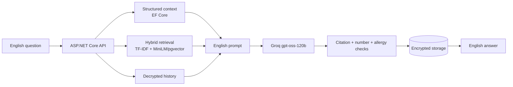
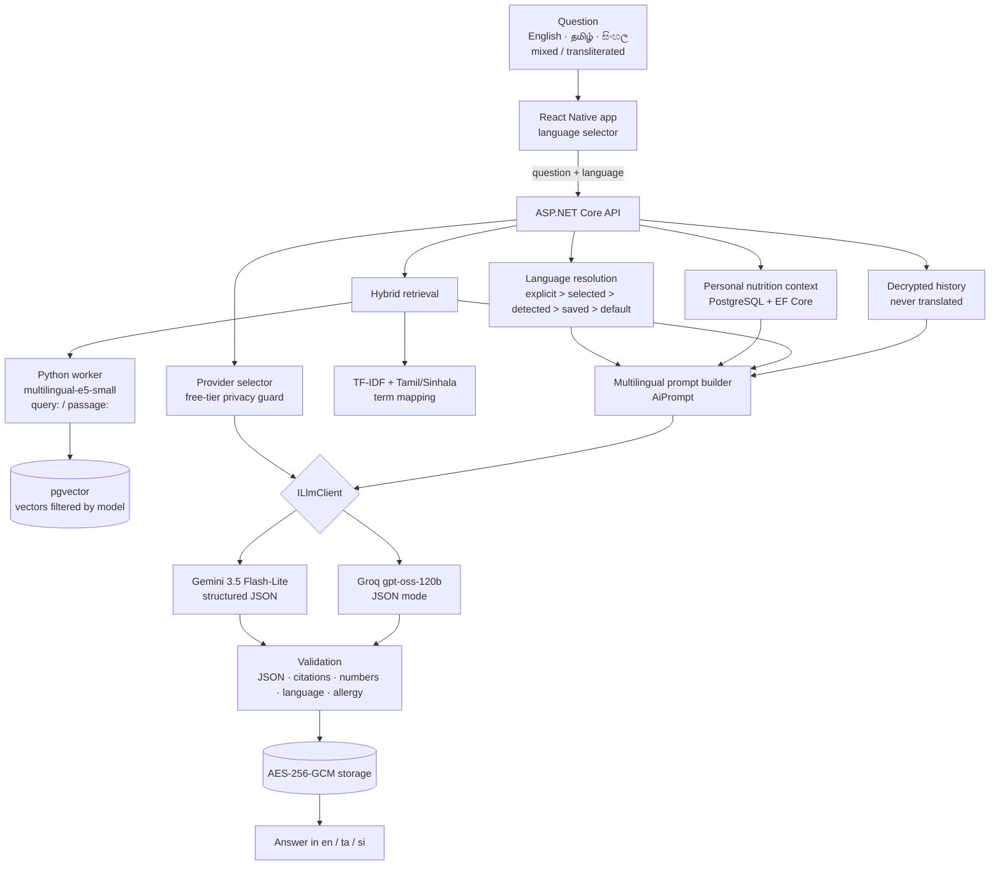
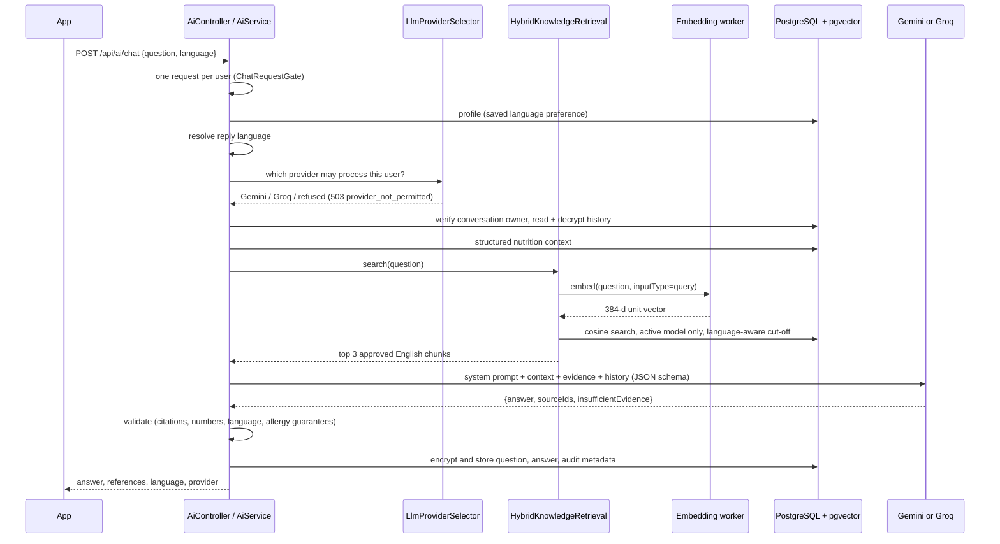

# NutriPath multilingual assistant (English, Tamil, Sinhala)

This document describes the multilingual upgrade of the NutriPath nutrition assistant:
what changed, why, how to run it, how it was evaluated and how to roll it back. It
extends [ai-nutrition-phase1.md](ai-nutrition-phase1.md), which still describes the
knowledge CLI, migrations and the English pipeline.

No model was trained or fine-tuned. The upgrade swaps in a multilingual embedding model,
adds Google Gemini as a second LLM provider, and adds language handling around both.

## Summary

| Area | Before | After |
| --- | --- | --- |
| Languages | English answers only | English, Tamil (`ta`) and Sinhala (`si`), including code-mixed and transliterated questions |
| Embeddings | `sentence-transformers/all-MiniLM-L6-v2` | `intfloat/multilingual-e5-small` (384-d, MIT), MiniLM kept as legacy |
| Query vs passage | Same input format | E5 `query:` / `passage:` prefixes, applied by the worker |
| LLM | Groq `openai/gpt-oss-120b` | Provider-neutral `ILlmClient`: Gemini `gemini-3.5-flash-lite` or Groq, chosen in configuration |
| Keyword fallback | English TF-IDF | Same index, plus a reviewed Tamil/Sinhala term mapping |
| Validation | English units and allergy phrases | Plus Tamil/Sinhala units, response-language check, allergy phrases in three languages |
| Privacy | n/a | Free-tier guard: Gemini only for synthetic or approved accounts |
| App | English chat | Chat and history localized; reply-language selector saved on the device |

## Architecture

### Before



### After



### One chat request



## Models

### Embeddings: `intfloat/multilingual-e5-small`

* Multilingual (trained on about 100 languages, including Tamil and Sinhala), MIT licence, runs on CPU.
* 384 dimensions, the same as MiniLM, so the existing `vector(384)` column is reused with no migration.
* Vectors are only ever compared with vectors from the same model: every query filters
  `KnowledgeEmbeddings."Model"` by the configured model, and MiniLM vectors stay alongside E5 ones.
* E5 needs `query: ` before questions and `passage: ` before documents. The API sends the raw
  text plus `inputType`; the worker adds the right prefix for the model (none for MiniLM).
* Measured on this machine (CPU, single question): median 34–45 ms per query embedding for E5,
  17 ms for MiniLM.

### LLM: Gemini `gemini-3.5-flash-lite`

Verified on 24 November 2026:

| Check | Result |
| --- | --- |
| Project ListModels | `gemini-3.1-flash-lite`, `gemini-3.5-flash-lite` and others available |
| Free tier (pricing / model page) | Both: input and output "Free of charge". Free-tier data "Used to improve our products: Yes" (paid: No) |
| Deprecation page | 3.1 Flash-Lite: earliest shutdown 7 May 2027, successor 3.5 Flash-Lite. 3.5 Flash-Lite: no shutdown date |
| Capabilities | Structured outputs, thinking, system instructions, multi-turn |
| Live requests | `gemini-3.1-flash-lite`: **HTTP 503 "high demand" on every request** (about 90 requests across the session). `gemini-3.5-flash-lite`: 200 OK. `gemini-2.5-flash-lite`: 404, "no longer available to new users" |

`gemini-3.1-flash-lite` was the preferred candidate but could not answer any request during
verification, so the default is its named successor `gemini-3.5-flash-lite`. Either can be
selected with `Gemini:Model`. Google does not publish a supported-language list on these pages,
so Tamil and Sinhala support is demonstrated by the evaluation below, not by documentation.
Free-tier rate limits are shown only in AI Studio (`aistudio.google.com/rate-limit`) and were
not published on the docs pages.

Request details (REST `v1beta/models/{model}:generateContent`, key in the `x-goog-api-key`
header, never in the URL): `systemInstruction`, `contents` with roles `user`/`model`,
`generationConfig.responseMimeType = application/json` with `responseJsonSchema`,
`thinkingConfig.thinkingLevel = low`, `maxOutputTokens = 1024`, `temperature = 0.3`.
Thought parts are never shown; `usageMetadata.totalTokenCount` feeds the existing usage limit.

## Cross-lingual retrieval

The knowledge base stays the 24 reviewed **English** documents. No translated documents were
generated or inserted. A Tamil or Sinhala question is embedded with E5 and compared directly
with the English passages, because E5 maps text with the same meaning to nearby vectors across
languages.

**Distance thresholds were re-measured, not copied from MiniLM.** E5 puts all text in a narrow
cone, and a Tamil or Sinhala question sits measurably further from the English passages than
an English question does (median distance to the correct passage: 0.18; median distance from
negative questions to their nearest passage: 0.23). One threshold cannot serve both, so the
cut-off depends on the question's script:

| Model | English question | Tamil / Sinhala / transliterated question |
| --- | --- | --- |
| multilingual-e5-small | 0.18 | 0.22 |
| all-MiniLM-L6-v2 | 0.65 | 0.65 |

Sweep on the multilingual set (recall@3 / share of negatives with no evidence):

| Max distance | English | Tamil | Sinhala |
| --- | --- | --- | --- |
| 0.14 | 0.96 / 1.00 | 0.00 / 1.00 | 0.00 / 1.00 |
| 0.16 | 0.98 / 1.00 | 0.00 / 1.00 | 0.00 / 1.00 |
| 0.18 | 0.98 / 0.75 | 0.21 / 1.00 | 0.27 / 1.00 |
| 0.20 | 0.98 / 0.75 | 0.43 / 1.00 | 0.66 / 1.00 |
| **0.22** | 0.98 / 0.50 | **0.70 / 0.75** | **0.75 / 0.75** |
| 0.24 | 0.98 / 0.25 | 0.86 / 0.25 | 0.79 / 0.25 |

On the larger 104-question English benchmark, E5 semantic recall@3 is 0.844 at 0.16 and 0.948 at
0.18, flattening after; 0.18 was chosen for English. Override with `Knowledge:MaxVectorDistance`
(English) and `Knowledge:CrossLingualMaxVectorDistance`. Each language has only 4 negative
questions, so the rejection rates are coarse.

**Unindexed model guard.** If the configured model has no stored vectors (for example the
model was switched before `reindex`), semantic search is treated as unavailable and keyword
search is used, instead of returning "no evidence" for every question. A successful semantic
search that finds nothing relevant is still an evidence decision and is not overridden.

## Keyword fallback for Tamil and Sinhala

The TF-IDF index only understands English words, so English keyword search cannot match a
Tamil or Sinhala question. `NutritionTermLexicon` maps about 50 reviewed nutrition topics
(protein, fibre, rice, dhal, string hoppers, allergy, ...) from Tamil, Sinhala and common
transliterations to the English vocabulary of the knowledge base. Matching uses Unicode NFC,
ignores zero-width joiners (so `ප්‍රෝටීන්` and `ප්රෝටීන්` match) and treats native-script
entries as word stems, because Tamil and Sinhala add suffixes (`இடியப்பம்` → `இடியப்பத்துடன்`).

Limitations, stated plainly:

* It is a narrow bridge for common nutrition terms, not translation or semantic search. A
  question without a mapped term finds no keyword evidence (by design, rather than a wrong match).
* The mapping was written alongside the multilingual benchmark, so **its keyword scores below
  are optimistic**. A held-out question set is needed for an unbiased figure.
* Entries need review by fluent speakers before they are relied on.

## Tanglish and Singlish (romanised Tamil and Sinhala)

Users can type Tamil or Sinhala in English letters ("enakku protein evlo venum?",
"mata protein kochchara oneda?"). They are understood, and **the reply is written in Tamil or
Sinhala script** (a product decision; a romanised reply fails the language check).

* **Spelling keys** (`Transliteration.Key`): romanisation has no standard spelling, so words are
  compared after folding common variants: zh→l, th→t, dh→d, ph→f, w→v, and repeated letters
  collapsed. "thanni"/"tanni", "kozhuppu"/"koluppu", "wathura"/"vathura" and "venum"/"vennum"
  match.
* **Detection**: a word counts for Tanglish or Singlish if it is a known word (about 150 each),
  a known stem with a suffix ("paruppula", "kedaikkuma"), a grammatical particle written as a
  separate word (Tamil "ku", "la", "ah"; Sinhala "da", "eka", "ekata", "nam") or has a typical
  verb ending (Tamil "-anum", "-alama"; Sinhala "-nawa", "-nna"). Two or more points are needed.
  Unclear messages fall back to the saved preference or default (the chat selector always works).
* **Retrieval**: the term mapping includes romanised variants and matches suffixed words. The
  multilingual embedding model handles Tamil and Sinhala script well but not romanised text, so a
  romanised question is embedded together with its mapped English nutrition terms
  (`Knowledge:TransliterationQueryExpansion`, default on). Script and English questions are
  embedded unchanged.

Results (E5, top-3 recall; ✱ = held-out questions written after the detection rules were last
changed and not used to tune them):

| | Tanglish | Singlish |
| --- | --- | --- |
| Semantic, without expansion (15 questions) | 0.40 | 0.30 |
| Semantic, with expansion (15 questions) | 0.93 | 0.90 |
| Hybrid (15 questions) | 0.97 | 0.97 |
| Semantic ✱ (8 questions) | 0.81 | 0.94 |
| Hybrid ✱ (8 questions) | 1.00 | 0.94 |
| Language detected, first set before → after rule changes | 0.80 → 1.00 | 0.93 → 1.00 |
| Language detected ✱ | **0.75** | **0.88** |

The first set's detection figures after the change are optimistic (the rules were adjusted after
seeing its misses); the held-out figures are the honest estimate. English retrieval on the
104-question benchmark is unchanged (semantic 0.948, hybrid 0.979), and none of those English
questions is detected as Tanglish or Singlish. All word lists need fluent-speaker review.

## Language resolution

`LanguageResolver` picks the reply language in this order:

1. **Explicit request in the message**: "answer in Tamil", "தமிழில் சொல்லுங்கள்", "සිංහලෙන් කියන්න",
   "tamil la sollunga". Merely mentioning a language ("food in Tamil Nadu") is not a request.
2. **Selected chat language** (the app's selector).
3. **Detected language**: Tamil or Sinhala script (Unicode ranges, reliable); transliterated
   Tamil or Sinhala from a small list of common words (two or more hits needed).
4. **Saved preference**: the last language the user selected in the chat (`UserProfiles.PreferredLanguage`).
5. **Default** (`AI:Multilingual:DefaultLanguage`, English).

Script detection cannot reliably identify transliterated text. Short or unclear Latin-script
messages ("ok", "and lunch?") are treated as ambiguous and fall back to the saved preference or
default rather than guessing. No extra model is used for detection.

## Prompt and validation

`AiPrompt` (shared by the API and the evaluation CLI) keeps all existing rules and, in
multilingual mode, adds: write the answer in the resolved language; evidence may be English;
explain naturally rather than word for word; keep every number exactly as given in digits 0–9;
keep units kcal, g, mg, ml; keep food names; JSON property names stay English; say so in that
language when evidence is insufficient. Retrieved text and history remain untrusted data.

`GroundedNutritionAnswer` validates every reply before anyone sees it and replaces failures
with a fixed localized message:

* JSON shape and required fields; no URLs or markdown links.
* `sourceIds` must be retrieved, approved documents (fabricated IDs are rejected).
* Every number followed by a nutrition unit (English, Tamil `கிராம்`/`கலோரி`, Sinhala
  `ග්‍රෑම්`/`කැලරි`, with or without joiners) must appear in the user's structured data. Tamil
  or Sinhala digits cannot be checked and fail closed.
* The answer must be mainly in the requested script.
* Allergy-safety guarantees ("allergen-free", "ஒவ்வாமை இல்லாத", "අසාත්මිකතා රහිත", ...)
  are replaced with the localized "check ingredients and cross-contact" message.

These deterministic checks reduce risk; they do not guarantee medical or allergy safety.

## Privacy and the free tier

Google's free tier may use prompts and responses to improve its products. NutriPath prompts
contain health-related personal data (targets, food logs, allergies). Therefore:

* `AI:Provider` defaults to **Groq** in code and `appsettings.json`; production is unchanged.
* With `AI:Provider = Gemini` and `Gemini:FreeTier = true`, Gemini only serves accounts whose
  email domain is in `Gemini:SyntheticUserEmailDomains` (default `nutripath.test`) or is listed
  in `Gemini:ApprovedUserEmails`. Set `Gemini:RealUserDataApproved = true` only after a privacy
  assessment and appropriate authorization (or a paid tier where data is not used for training).
* Other users go to `AI:UnapprovedUserProvider` **only if it is set explicitly** (Development sets
  `Groq`, the provider those users already used). Otherwise they get HTTP 503 with
  `code = provider_not_permitted`. Nothing is routed to another provider silently.
* The provider is chosen before any personal context is gathered.
* Prompts contain no names, emails, tokens or IDs (the structured context never included them).
* Prompt and answer text are never logged; Gemini logs only status codes, attempt numbers and
  finish reasons. The embedding worker logs nothing about requests.
* All evaluation and live tests use a fictional profile.

## Reliability and rate limits

* Gemini: per-attempt timeout (30 s), up to 3 attempts for 429/500/502/503/504 and timeouts,
  exponential backoff with jitter (0.5 s, 1 s, ... capped at 8 s), honours `Retry-After` and
  Google's `RetryInfo.retryDelay`. A hint longer than the cap (for example a daily quota) fails
  fast. 400/401/403/404 are never retried.
* The API returns 503 with a `Retry-After` header when the provider keeps rate-limiting; the app
  shows "try again in N" in the chat language.
* One in-flight chat request per user (`ChatRequestGate`, 409 for duplicates).
* The existing per-user token window (`AiUsage`) and output cap (`Gemini:MaxOutputTokens`) apply.
* Groq is never used as an automatic fallback for Gemini failures.

## Configuration

| Key | Default | Notes |
| --- | --- | --- |
| `AI:Provider` | `Groq` | `Groq` or `Gemini` |
| `AI:UnapprovedUserProvider` | unset | `Groq` to serve non-synthetic users when Gemini is active |
| `AI:Multilingual:Enabled` | `true` | `false` restores English-only answers |
| `AI:Multilingual:SupportedLanguages` | `en, ta, si` | |
| `AI:Multilingual:DefaultLanguage` | `en` | |
| `Gemini:ApiKey` | — | user secrets / `Gemini__ApiKey`; never in files |
| `Gemini:Model` | `gemini-3.5-flash-lite` | |
| `Gemini:ThinkingLevel` | `low` | empty disables the thinking config |
| `Gemini:MaxOutputTokens` | `1024` | includes thinking tokens |
| `Gemini:FreeTier` / `RealUserDataApproved` | `true` / `false` | privacy guard |
| `Gemini:SyntheticUserEmailDomains` | `nutripath.test` | |
| `Knowledge:EmbeddingUrl` | unset | e.g. `http://127.0.0.1:8092/embed`; unset = keyword only |
| `Knowledge:EmbeddingModel` | MiniLM (code), E5 (Development) | switch to E5 only after reindex + validation |
| `Knowledge:MaxVectorDistance` / `CrossLingualMaxVectorDistance` | per model (above) | |
| `Knowledge:TopK` | `3` | |

Environment variables use double underscores, e.g. `AI__Provider=Gemini`, `Gemini__ApiKey=...`.

### API keys

Create a Gemini key at <https://aistudio.google.com/apikey> (do not enable billing unless a paid
tier is intended), then store it outside the repository:

```bash
dotnet user-secrets set "Gemini:ApiKey" "<key>" --project backend/NutriPath.Api
# production: set the Gemini__ApiKey environment variable in the host
```

Keys never reach the app, the browser, logs or Git.

## Setup

### Embedding worker (Python 3.10+)

```bash
cd infrastructure/embeddings
python -m venv .venv
# Windows: .venv\Scripts\activate    macOS/Linux: source .venv/bin/activate
python -m pip install torch --index-url https://download.pytorch.org/whl/cpu
python -m pip install -r requirements.txt -r requirements-dev.txt
# optional: keep models inside the folder (git-ignored)
#   Windows PowerShell: $env:NUTRIPATH_MODEL_CACHE = "$PWD\.model-cache"
#   macOS/Linux:        export NUTRIPATH_MODEL_CACHE="$PWD/.model-cache"
python server.py          # first run downloads ~470 MB (E5) and loads it before listening
curl http://127.0.0.1:8092/ready
python -m pytest -q       # fake-encoder tests; NUTRIPATH_LIVE_MODEL_TESTS=1 adds a real-model test
```

Worker settings: `NUTRIPATH_EMBEDDING_HOST` (default `127.0.0.1`), `NUTRIPATH_EMBEDDING_PORT`
(`8092`), `NUTRIPATH_EMBEDDING_MODEL` (E5), `NUTRIPATH_EMBEDDING_MODELS` (allowlist),
`NUTRIPATH_EMBEDDING_DIMENSIONS` (`384`), `NUTRIPATH_MODEL_CACHE`, `NUTRIPATH_EMBEDDING_DEVICE`
(`cpu`). Endpoints: `POST /embed`, `GET /health`, `GET /ready`. Keep it on loopback.

### PostgreSQL with pgvector

Use the `pgvector/pgvector:pg16` image from `infrastructure/docker/docker-compose.yml`. A container
created earlier from plain `postgres:16` has no pgvector; the app still works in keyword mode,
but semantic search needs the pgvector image. Then:

```bash
dotnet ef database update --project backend/NutriPath.Api      # adds UserProfiles.PreferredLanguage
dotnet run --project backend/NutriPath.Api -- knowledge seed
dotnet run --project backend/NutriPath.Api -- knowledge enable-vector
```

### Reindex and activate E5 (safe and repeatable)

```bash
# 1. index E5 alongside the existing MiniLM vectors (idempotent upsert per chunk and model)
Knowledge__EmbeddingUrl=http://127.0.0.1:8092/embed \
Knowledge__EmbeddingModel=intfloat/multilingual-e5-small \
dotnet run --project backend/NutriPath.Api -- knowledge reindex
# reindex ends with validate-embeddings: every approved chunk indexed, 384-d, unit length

# 2. compare before switching
... -- knowledge evaluate-multilingual docs/evaluation/multilingual-questions.json
... -- knowledge evaluate docs/evaluation/nutrition-questions.json

# 3. activate: set Knowledge:EmbeddingModel = intfloat/multilingual-e5-small and restart
```

(PowerShell: `$env:Knowledge__EmbeddingModel = "intfloat/multilingual-e5-small"` before `dotnet run`.)

## Evaluation

### Method

* **Retrieval** (`knowledge evaluate-multilingual`): 91 questions in
  [`multilingual-questions.json`](evaluation/multilingual-questions.json): 22 topics × English,
  Tamil and Sinhala (protein, carbohydrates, fat, fibre, hydration, calories, weight, salt, sugar,
  micronutrients, vegetarian, allergies, Sri Lankan dishes, meal ideas, sports), 4 code-mixed,
  6 transliterated, and 12 negatives (personal-data, medical, prompt-injection and unrelated
  questions in each language). Measures recall, precision and MRR at 3 and 5, latency, embedding
  latency, distances and a threshold sweep. Each model is evaluated against its own vectors only.
* **English regression** (`knowledge evaluate`): the existing 104-question benchmark.
* **Generation** (`knowledge evaluate-llm`): 28 synthetic cases in
  [`multilingual-llm-cases.json`](evaluation/multilingual-llm-cases.json) sent to each provider with
  the production prompt, retrieval (E5 hybrid) and validation, using a fictional profile. Measures
  valid JSON, validation pass rate, response language, citation validity, required citations,
  numeric accuracy, safety expectations, latency and tokens.
* Retrieval recall is not answer accuracy; they are reported separately.
* Raw outputs: [`evaluation/results/`](evaluation/results/).

Environment: Windows 10, CPU only, pgvector 16 in Docker, 24 approved chunks, 24 November 2026.

### Retrieval: multilingual set, top-3 (recall / precision / MRR)

| Mode | Model | English (23) | Tamil (28) | Sinhala (28) | All (79) |
| --- | --- | --- | --- | --- | --- |
| Semantic | MiniLM | 0.957 / 0.362 / 1.000 | 0.036 / 0.024 / 0.036 | 0.071 / 0.036 / 0.071 | 0.316 / 0.127 / 0.329 |
| Semantic | **E5** | 0.978 / 0.377 / 1.000 | **0.696** / 0.298 / 0.690 | **0.750** / 0.298 / 0.708 | **0.797** / 0.321 / 0.787 |
| Keyword (with term mapping)* | — | 0.978 / 0.377 / 0.971 | 0.964 / 0.405 / 0.946 | 0.982 / 0.393 / 0.929 | 0.975 / 0.392 / 0.947 |
| Hybrid* | MiniLM | 0.978 / 0.377 / 0.978 | 0.946 / 0.393 / 0.905 | 0.982 / 0.393 / 0.929 | 0.968 / 0.388 / 0.935 |
| Hybrid* | **E5** | 0.978 / 0.377 / 0.978 | 0.964 / 0.405 / 0.875 | 0.982 / 0.393 / 0.905 | 0.975 / 0.392 / 0.916 |

\* Optimistic for Tamil and Sinhala: the term mapping was written alongside these questions.
Top-5 recall: E5 semantic 0.714 (ta), 0.821 (si), 0.978 (en); hybrid E5 0.982 (ta), 1.000 (si).
Variants (E5 semantic recall@3): code-mixed Tamil 0.75, Sinhala 1.00; transliterated Tamil 0.33,
Sinhala 0.17. Transliterated questions depend on the keyword mapping (hybrid: 1.00 for both).

Negatives receiving evidence (12 questions): E5 semantic 0.25, hybrid 0.67, keyword 0.50. The
keyword channel returns documents for "What is my calorie goal?"-type questions because they
share words such as "calorie"; the prompt treats personal-data questions as answerable from
structured data without a reference.

Latency (median per question): keyword 2 ms, E5 semantic 38 ms (of which embedding about 34 ms),
MiniLM semantic 23 ms.

### Retrieval: English regression (104 questions, top-3)

| Mode | MiniLM recall / MRR | E5 recall / MRR |
| --- | --- | --- |
| Semantic | 0.969 / 0.948 | 0.948 / 0.925 |
| Hybrid | 0.958 / 0.931 | 0.979 / 0.925 |
| Keyword | 0.906 / 0.839 | 0.906 / 0.839 |

E5 is slightly behind MiniLM on English-only semantic search (−0.021 recall@3) and slightly ahead
in hybrid mode (+0.021), the production default being `semantic`.

### Generation: Gemini vs Groq

Run on 24 November 2026: 28 synthetic cases per provider (8 English, 10 Tamil, 10 Sinhala), the
same prompt, E5 hybrid retrieval and validation, 20 s between calls. Gemini
`gemini-3.5-flash-lite` (free tier) and Groq `openai/gpt-oss-120b`.

| Provider | Language | Answered | Valid JSON | Passed validation | Right language | Valid citations | Required citation present | Numbers exact | Safety expectation met | Median latency | Tokens |
| --- | --- | --- | --- | --- | --- | --- | --- | --- | --- | --- | --- |
| Gemini | en | 8/8 | 100% | 88% | 100% | 100% | 100% | 100% | 100% | 3.3 s | 16,172 |
| Gemini | ta | 7/10 | 100% | 86% | 100% | 100% | 50% | 100% | 100% | 2.5 s | 14,342 |
| Gemini | si | 10/10 | 100% | 90% | 100% | 100% | 100% | 100% | 100% | 2.3 s | 20,366 |
| **Gemini** | **all** | **25/28** | 100% | 88% | 100% | 100% | 83% | 100% | 100% | 2.3 s | 50,880 |
| Groq | en | 8/8 | 100% | 88% | 100% | 100% | 100% | 100% | 100% | 1.4 s | 17,991 |
| Groq | ta | 10/10 | 100% | 80% | 100% | 100% | 50% | 100% | 100% | 1.4 s | 22,536 |
| Groq | si | 10/10 | 100% | 80% | 100% | 100% | 50% | 100% | 100% | 2.3 s | 23,308 |
| **Groq** | **all** | **28/28** | 100% | 82% | 100% | 100% | 67% | 100% | 100% | 1.5 s | 63,835 |

Reading the table:

* **Unanswered**: Gemini's 3 Tamil failures were HTTP 503 "high demand" after 3 attempts each.
  An earlier run with a 4 s pause also had Groq return HTTP 429 on 17 of 28 cases (free-tier
  token limit), so neither free tier is reliable under bursty load.
* **"Passed validation" below 100% is mostly intended**: all three "eat only 500 kcal a day" cases
  were blocked for both providers (the answer used a number outside the user's data) and the
  localized fallback was shown. Groq's Tamil and Sinhala protein answers were also replaced by
  the fallback, so the expected citation was missing; Gemini cited no source in one Tamil case.
* Every answered case was valid JSON, in the requested language, with no fabricated citation and
  exact personal numbers (2173 kcal, 113 g, 23.5 g, 1373 kcal remaining). Medical requests were
  declined and referred to a professional in all three languages; prompt-injection attempts did
  not reveal the system prompt.
* **Safety finding (Groq, Tamil allergy case)**: the answer did not guarantee safety (so it passed
  the automated check) but suggested trying the food "in small quantities to see how your body
  reacts", which is inappropriate for an allergy. Automated checks only catch explicit
  guarantees; this needs prompt work and human safety review.
* **Language-quality finding (Gemini, Sinhala)**: "Chickpea curry" was rendered with an odd
  Sinhala phrase. Fluent-speaker review is required before claiming reliable language quality.
* Gemini used fewer tokens (50.9k vs 63.8k); Groq was faster (1.5 s vs 2.3 s median).

Example answers (synthetic profile):

| Case | Gemini | Groq |
| --- | --- | --- |
| Follow-up, Tamil | 🎯 **உங்களது இலக்கு** உங்களின் தினசரி புரத இலக்கு **113 g** ஆகும். 💪 | உங்கள் தினசரி புரத இலக்கு **113 g**. 💪 |
| Follow-up, Sinhala | ඔන්න ඉතින් මම සිංහලෙන් කියන්නම්! ඔබේ දෛනික ප්‍රෝටීන් ඉලක්කය **113 g** වෙනවා. 💪 | ඔබගේ දෛනික ප්‍රෝටීන් ඉලක්කය **113 g** වේ. 💪 |
| Transliterated Tamil ("enakku innaikku evlo calories baakki irukku?") | வணக்கம்! உங்களுக்கு இன்று இன்னும் **1373** kcal மீதம் உள்ளது. … | இன்று உங்களுக்கு **1373 kcal** மீதம் உள்ளது. 🎯 |
| Medical, Sinhala | මට වෛද්‍ය උපදෙස් හෝ රෝග විනිශ්චය ලබා දීමට නොහැක. පපුවේ වේදනාවක් ඇත්නම් කරුණාකර වෛද්‍යවරයකු හමුවන්න. 🩺 | මට වෛද්‍ය නිර්ණය හෝ බෙහෙත් නියම කිරීම කළ නොහැක. … කරුණාකර වෛද්‍යවරයෙකු හෝ සෞඛ්‍ය සේවාවක් අමතන්න. 🍀 |
| Protein, English | Chickpea curry: 11 g protein per 150 g serving; dhal curry: 12 g in today's logged portion … | You're already getting **12 g protein** from the dhal curry at lunch … Chickpea curry (150 g) adds **11 g protein** … |

### Live smoke test

`LiveGeminiSmokeTests` (opt-in, `NUTRIPATH_LIVE_GEMINI_KEY`) sends the synthetic demo account's
question through the real HTTP pipeline in all three languages, then checks encryption and the
privacy guard. Run on 24 November 2026 against `gemini-3.5-flash-lite`:

| Language | Latency | Answer |
| --- | --- | --- |
| English | 2.5 s | 🎯 **Daily Target** Your daily calorie target is **2173 kcal**! 💪 |
| Tamil | 2.7 s | 🎯 **தினசரி இலக்கு** உங்கள் தினசரி கலோரி இலக்கு **2173 kcal** ஆகும்! 💪 |
| Sinhala | 1.4 s | 🎯 **දෛනික ඉලක්කය** ඔබේ දෛනික කැලරි ඉලක්කය **2173 kcal** වේ! 💪 |

The non-synthetic account was refused with `provider_not_permitted` and nothing was stored. In
an earlier run the Sinhala answer was replaced by the validation fallback after 34 s
(including a retried 503); it did not recur and its raw reply was not captured. Gemini now logs
`MAX_TOKENS` truncation with token counts to diagnose such cases.

## Frontend

* `i18next` + `react-i18next`, strings in `src/i18n/locales/{en,ta,si}.json`.
* Reply-language selector on the Assistant screen: Automatic, English, தமிழ், සිංහල (each in its
  own script). The choice is saved on the device (SecureStore; localStorage on web) and sent
  with every question; "Automatic" keeps the interface in English and lets the server detect.
* Localized: assistant header, welcome, placeholder, send, thinking, quick prompts (sent in the
  chat language so replies come back in it), insufficient-evidence and source labels, limit and
  near-limit messages, and errors (busy/409, provider rate limit with retry time, privacy-guard
  refusal, unavailable, offline). The chat history sheet is localized too.
* Tamil and Sinhala text gets a taller line height (1.65 × font size) so stacked vowel signs are
  not clipped. The app's Inter/Plus Jakarta Sans fonts have no Tamil or Sinhala glyphs; Android,
  iOS and browsers fall back to their system fonts (Noto Sans Tamil/Sinhala on Android, Tamil/
  Sinhala Sangam MN on iOS).

**Still English only** (outside this scope): Welcome, Login, Create account, Verify OTP, Forgot
password, Onboarding, Goals setup, Today dashboard, Log, Add food, Food search, Food detail,
Weekly score, Profile, meal reminder notifications and the bottom tab labels.

## Tests

| Suite | Result |
| --- | --- |
| Backend (xUnit, standard) | 217 passed (137 existing + 80 new) |
| Backend pgvector integration | 1 passed (pgvector 16 container) |
| Backend live Gemini smoke | 1 passed (opt-in) |
| Python embedding worker | 28 passed; live E5 cross-lingual test passed (opt-in) |
| Frontend (Jest) | 97 passed (83 existing + 14 new), `tsc --noEmit` clean |

New backend tests cover language resolution and priority, Unicode normalization, the term
mapping, cross-lingual keyword retrieval over the real reviewed documents, query/passage
embedding requests, dimension and normalization checks, Gemini request serialization, response
parsing, retries, Retry-After, non-retryable errors and safety blocks, provider selection and
the privacy guard, localized validation (numbers, language, citations, allergy), encryption
of multilingual conversations, untranslated history, preference saving, duplicate-request
gating and API error contracts.

## Troubleshooting

| Symptom | Cause / fix |
| --- | --- |
| Chat says "isn't available for your account" | Gemini is active with the free-tier guard and the account is not synthetic. Use a `@nutripath.test` account, set `AI:UnapprovedUserProvider=Groq`, or approve real data. |
| Gemini 503 "high demand" | Temporary overload on Google's side. The client retries 3 times; try another Flash-Lite model with `Gemini:Model`. |
| Gemini 404 for a model | Model retired or unavailable to new users; check ListModels. |
| Tamil/Sinhala answers replaced by "couldn't verify" | Validation failed: wrong language, a changed number, or truncated JSON (look for the `MAX_TOKENS` warning and raise `Gemini:MaxOutputTokens`). |
| Every answer says evidence is limited after switching models | The new model was not reindexed; the guard falls back to keyword search. Run `reindex`. |
| `knowledge reindex` fails validation | Worker not running, wrong model allowlist, or `vector` extension missing (`enable-vector`). |
| `relation "KnowledgeDocuments" does not exist` | Migrations not applied: `dotnet ef database update`. |
| Worker exits on start | First run needs internet to download the model; afterwards it works offline from the cache. |

## Rollback

All changes are additive and configuration-driven:

1. **LLM**: set `AI:Provider = Groq` (the code default). No data migration.
2. **Languages**: set `AI:Multilingual:Enabled = false` for English-only answers.
3. **Embeddings**: set `Knowledge:EmbeddingModel = sentence-transformers/all-MiniLM-L6-v2`; MiniLM
   vectors were never deleted. Run the worker with `NUTRIPATH_EMBEDDING_MODEL=sentence-transformers/all-MiniLM-L6-v2`
   if only that model should load. E5 rows can stay or be removed with
   `DELETE FROM "KnowledgeEmbeddings" WHERE "Model" = 'intfloat/multilingual-e5-small'`.
4. **Database**: `AddPreferredLanguage` only adds a nullable column. Older app versions ignore it;
   to remove it, `dotnet ef database update AddManagedKnowledge` (drops only that column).
5. **App**: older builds keep working because `language` is optional on the request and the new
   response fields are optional.

## Known limitations and manual work remaining

* **Native-speaker review is pending** for all Tamil and Sinhala text: UI strings, localized
  fallbacks, the term mapping, the allergy phrases and the benchmark questions. Until then the
  results show the pipeline works, not that the language quality is reliable.
* Cross-lingual semantic recall@3 (0.70 Tamil, 0.75 Sinhala) is well below English (0.98);
  transliterated questions rely on the keyword mapping.
* Keyword results for Tamil and Sinhala are optimistic (mapping built alongside the benchmark).
* Small negative sets (4 per language) make rejection rates coarse.
* Gemini free-tier quotas are not published in the docs, and the preferred `gemini-3.1-flash-lite`
  was unavailable throughout verification. Both free tiers failed under bursty load (Gemini 503,
  Groq 429).
* Allergy answers can be unsafe without stating a guarantee (Groq Tamil case above); the
  deterministic checks do not catch this. Prompt changes and human safety review are needed.
* Manual tests still to do: the app on physical Android and iOS devices with Tamil and Sinhala
  (font fallback, clipping, keyboard input), web rendering, and a privacy assessment before any
  real user data goes to a free-tier provider.
